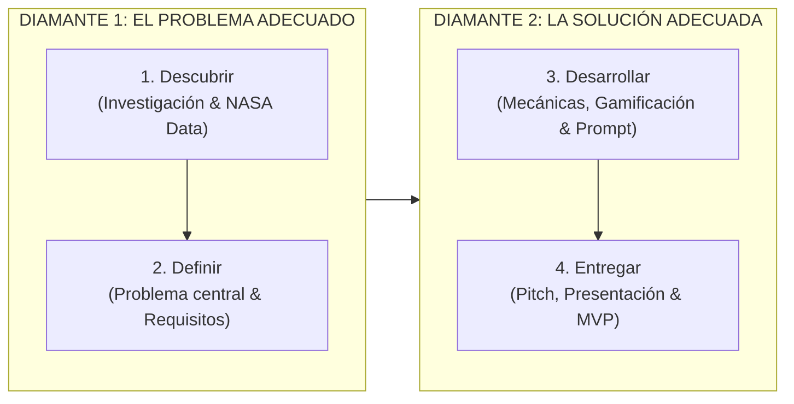

# Plan Estratégico & Gamificación: *Misión Umbral* (NASA Space Apps Challenge)

> **Propósito:** Transformar *Misión Umbral* de un simulador estático de presupuestos a una experiencia de juego memorable, desafiante y con rigor científico, utilizando la metodología del **Doble Diamante**.

---

## 💎 Metodología del Doble Diamante aplicada al Proyecto



---

## 1. Fase de Descubrimiento (Investigar / Divergencia)
*¿Qué busca el jurado de NASA Space Apps y qué misiones reales nos inspiran?*

### 1.1 Anclaje en Misiones Reales de la NASA
El juego deja de ser "genérico" cuando cada variable tiene un referente histórico documentado:
* **Misión VIPER (Volatiles Investigating Polar Exploration Rover) & Artemis III:**
  * *Referencia real:* Exploración de cráteres permanentemente sombreados (PSRs) en el Polo Sur de la Luna para buscar hielo de agua.
  * *Dilema real:* En la sombra no hay luz solar para los paneles fotovoltaicos; cada metro recorrido consume batería finita criogénica y el terreno es regolito suelto traicionero.
* **Mars Perseverance & Curiosity:**
  * *Referencia real:* El balance entre masa de carga útil (*payload*) y coste de lanzamiento mediante grúa aérea (*Sky Crane*). La decisión crítica de perforar testigos de roca (*core samples*) y sellarlos.
* **New Horizons:**
  * *Referencia real:* Presupuesto de energía estrictamente asignado por vatios (RTG). Si un instrumento se enciende, otro debe apagarse.

### 1.2 El dolor del jugador actual vs. Lo que busca el jurado
* **El fallo común de proyectos de hackathon:** Simuladores aburridos que parecen tablas de Excel o juegos arcades que ignoran la física y la ciencia.
* **El punto dulce (Sweet Spot):** *Juego de tensión táctica por turnos / micro-roguelite espacial*. Aprender que **en el espacio, la masa es el enemigo número uno y la complacencia es mortal**.

---

## 2. Fase de Definición (Focalizar / Convergencia)
*Definición del núcleo del juego, reglas del desafío y requisitos.*

### 2.1 El Núcleo de Jugabilidad (*Core Loop*)
1. **Briefing & Presupuesto (Hangar):** Decidir la carga según el objetivo científico.
2. **Tránsito Incierto (En vuelo):** Lidiar con la telemetría y ajustar trayectoria con combustible limitado.
3. **Exploración en Superficie (Tensión de Recursos):** Cada paso gasta batería y oxígeno; cada metro hacia el cráter aumenta el riesgo de quedar atrapado.
4. **Veredicto y Consecuencias:** Retorno seguro con descubrimientos vs. Misión varada con análisis forense de la causa raíz.

### 2.2 Tabla de Recursos: ¿Qué se gana y qué se pierde?

| Escenario | Resultado In-Game | Recompensa Científica y Progreso (Gamificación) | Consecuencia / Lección de Ingeniería |
| :--- | :--- | :--- | :--- |
| **Éxito Óptimo** | Muestra extraída + Retorno al módulo con margen seguro (>10% reserva) | • **Prestigio de Agencia (+ reputación NASA)**<br>• Desbloqueo de patentes de instrumentos avanzados (ej. Espectrómetro NIRVSS).<br>• Fondos extras para la siguiente misión. | El diseño equilibrado premió la previsión sin sobrecoste. |
| **Éxito Ajustado** | Muestra extraída con batería en reserva crítica (<5% reserva) | • Muestra asegurada pero con desgaste de reputación por arriesgar la misión.<br>• Mención de honor: *"Medalla de Ingenio Artemis"*. | Salvaste la misión por suerte o maniobra heroica, pero el margen de error fue insostenible. |
| **Misión Varada (Derrota)** | Se agotó la energía o el oxígeno antes de volver al módulo | • **Informe Forense de Telemetría (Post-Mortem):** gráfica exacta que muestra dónde falló la estimación.<br>• Obtención de **"Datos de Fallo"** (Data points acumulables) que abaratan el coste de simulación en el próximo intento. | En la NASA los fracasos educan. El juego no te castiga con frustración vacía, sino con datos claros: *"Te faltaron 8 Wh porque perforaste sin considerar la pendiente de salida"*. |
| **Catástrofe de Masa** | Sobrepeso en el lanzador o fallo estructural | • Cancelación en rampa o quema prematura de combustible. | Entendimiento instantáneo de la ecuación del cohete de Tsiolkovski. |

---

## 3. Fase de Desarrollo (Idear & Prototipar)
*Creatividad, balance justo y elementos diferenciadores.*

### 3.1 Balance: ¿Cómo lograr que sea Divertido pero Justo?
Para que el jugador no sienta que el juego hace trampa (*RNG injusto*):
1. **Información Asimétrica pero Visible:**
   * Las probabilidades del terreno no son ocultas: la Llanura marca `30% de riesgo de roca`, el Cráter marca `60%`.
   * El jugador asume el riesgo voluntariamente: *¿Voy a la zona segura y gano poco, o voy a la zona peligrosa por la muestra de alto impacto?*
2. **Mecánica de Salvación Táctica ("Abort & Return"):**
   * En todo momento el HUD muestra: `Energía necesaria para regresar = X Wh`.
   * Si el jugador ve que le quedan 35 Wh y regresar cuesta 34 Wh, tiene la decisión en sus manos: dar un paso más por codicia y perderlo todo, o activar la abortiva y salvar lo que tiene.

### 3.2 El Diferenciador: "¿Qué hace que este juego NO sea genérico?"
* **Representante / Mascota y Personalidad Dinámica:**
  * **"C.A.P.C.O.M. - AIDA" (Automated Intelligent Director of Astronautics):** Una IA de control de vuelo con personalidad estilo *Portal/Interstellar*, pragmática y científica, que reacciona con comentarios mordaces o felicitaciones sinceras a tus decisiones de peso y gasto.
* **Estilo Visual "Retro-NASA / Sci-Fi Vectorial":**
  * Estética de ordenadores de misión Apolo/Artemis (azules profundos `#0b1026`, ámbar de advertencia, verde fósforo de telemetría y pixel art técnico). No genérico de nave espacial arcade, sino panel de ingeniería táctil.
* **Efecto Huellas en la Escena:** Cada paso del astronauta va dejando un sendero de huellas en el regolito del cráter, mostrando visualmente cuánto te has alejado de la cápsula.

### 3.3 El Prompt de IA para el "Director de Vuelo" (Narrativa y Dinamismo)
Un prompt diseñado para alimentar un agente o asistente contextual en el juego que genera comentarios dinámicos basados en la telemetría:

```markdown
[ROL]: Eres FLIGHT-AI "AIDA", directora técnica de telemetría del Centro Espacial Johnson para la misión Umbral (Polo Sur Lunar / VIPER-Artemis).
[TONO]: Profesional, científico, riguroso, ligeramente irónico con las malas decisiones de presupuesto, apasionada por la física real.
[ENTRADAS]:
- Lanzador elegido: {cohete}
- Masa útil restante: {margen_masa} kg
- Energía reservada para retorno: {reserva_regreso} Wh
- Estado actual: {etapa} (Hangar / Tránsito / Superficie)
- Incidente: {evento_terreno} (Roca imprevista / Veta detectada)
[OBJETIVO]:
Genera un despacho de radio breve (máximo 2 líneas) transmitiendo urgencia y datos reales de ingeniería espacial. Si el jugador sobrecarga la nave con instrumentos innecesarios, recuérdale con ironía la ecuación de Tsiolkovski. Si queda varado, emite un informe de causa raíz constructivo basado en protocolos reales de la NASA.
```

---

## 4. Fase de Entrega (Priorización MoSCoW para el Jurado)

Para maximizar el impacto de la presentación sin dispersar esfuerzos en el hackathon:

| Prioridad | Característica / Entrega | Justificación ante el Jurado |
| :--- | :--- | :--- |
| **Must Have (Esencial)** | • Indicador visual continuo de "Punto de no Retorno" (Return Threshold).<br>• Informe post-partida con causa raíz gráfica basada en telemetría.<br>• Explicación explícita del vínculo con la misión VIPER/Artemis de la NASA. | Demuestra rigor pedagógico y elimina la frustración del jugador. |
| **Should Have (Importante)** | • Sistema de logros/consecuencias por estilo de juego (ej. *Ingeniero Conservador*, *Explorador Temerario*).<br>• Feedback de audio retro-mecánico / pitidos de telemetría de radio NASA.<br>• Comentarios dinámicos de la radio de control de misión. | Hace la experiencia envolvente y elimina la sensación de "hoja de cálculo". |
| **Could Have (Deseable)** | • Selector de misiones reales adicionales (Marte - Perseverance / Europa Clipper).<br>• Modo "Sandbox" con variables de gravedad ajustables. | Demuestra escalabilidad de la plataforma. |
| **Won't Have (Descartado)** | • Gráficos 3D pesados o físicas complejas de colisión que diluyan el mensaje de gestión y diseño. | Mantener el juego ultra-ligero, instantáneo y enfocado en la toma de decisiones. |

---

## 5. El Guión del Pitch: Cómo presentarlo al Jurado

1. **El Gancho (0:00 - 0:30):**
   > *"Diseñar una misión a la Luna no se trata de qué tan rápido conduces el rover, sino de cuántos vatios calculaste en la Tierra antes de despegar. Basado en los desafíos reales de la misión VIPER de la NASA en los cráteres sombreados lunares, creamos Misión Umbral."*
2. **El Conflicto (0:30 - 1:00):**
   > *"Mostramos en pantalla viva el drama del punto de no retorno: un paso más puede darte el descubrimiento del siglo o dejar a tu astronauta varado a 20 metros de la salvación por 3 Wh de energía."*
3. **La Solución Educativa (1:00 - 1:30):**
   > *"Cada fallo entrega datos forenses reales; cada victoria recompensa la optimización de ingeniería espacial real, no la suerte."*
